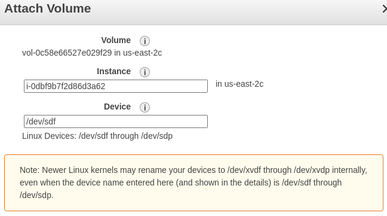
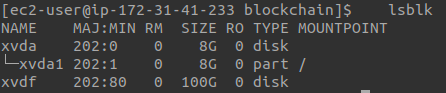
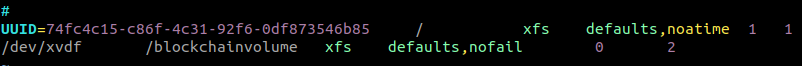
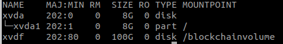
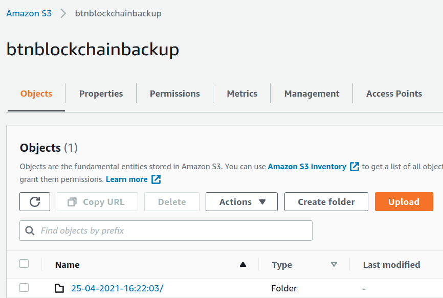
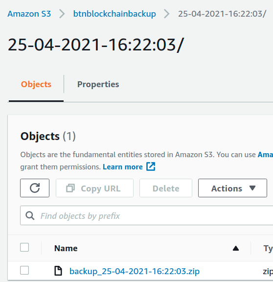
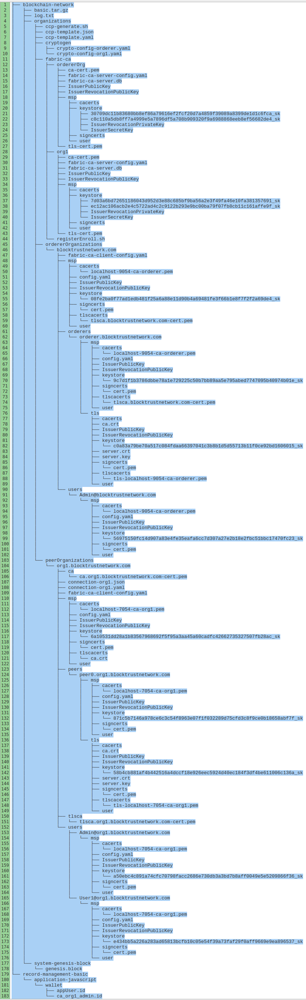

# **Table of Contents**
* [ Production ](#markdown-header-production)
    * [ Deployment ](#markdown-header-deployment)
        * [ AWS Resources Used in Production ](markdown-header-aws-resources-used-in-production)
        * [ Checklist ](#markdown-header-checklist)
        * [ ec2 Instance Setup ](#markdown-header-ec2-instance-setup)
        * [ Install Packages on ec2 Instance ](#markdown-header-package-installation-on-ec2-instance)
        * [ Persist Ledger Data ](#markdown-header-persist-ledger-data)
            * [ Mount an EBS Volume to EC2 Linux Instance ](#markdown-header-mount-an-ebs-volume-to-ec2-linux-instance)
            * [ Automount EBS Volume on Reboot ](#markdown-header-automount-ebs-volume-on-reboot)
            * [ Change the Default Location for Docker Volume Creation ](#markdown-header-change-the-default-location-for-docker-volume-creation)
        * [ Blockchain Network Setup ](#markdown-header-blockchain-network-setup)
        * [ Credentails Backup ](#markdown-header-credentails-backup)
        * [ Blockchain Network Restoration ](#markdown-header-blockchain-network-restoration)
* [ Production and Development ](#markdown-header-production-and-development)
      * [ Bring down the Blockchain Network ](#markdown-header-bring-down-the-blockchain-network)
* [ Local Testing ](#markdown-header-local-testing)
* [ Important Notes ](#markdown-header-important-notes)
* [ Client API ](#markdown-header-client-api)
* [ Other Configurations ](#markdown-header-other-configurations)

# ###################
# Production
# ###################

**Blockchain Network Structure**: one organization network setup with one peer, ordering service, and one certificate authority.

**Note**:
- `PROJECT_FOLDER` refers to the root directory of the whole project.   
- Whenever you need to execute a shell script in any "scripts" folder such as `PROJECT_FOLDER/scripts` and `PROJECT_FOLDER/blockchain-network/scripts`, you need to cd into the same directory as the script. Otherwise, you may run into directory not found error.

## **Deployment**

### **AWS Resources Used In Production**
1. **EC2 instance**: It holds the blockchain network server and its client API server (which is used to interact with smart contract/chaincode).
2. **EBS volume** - It is attached to the above EC2 instance and used as the default location for external Docker volumes. **NEVER** delete this EBS volume (unless you have a snapshot as a backup of the current data) since it stores the ledger(state database and blockchain).
3. **S3 bucket**- It contains a backup of credentials (certificates and keys used in authorization). If the EC2 instance is terminated by accident (*This should not happen since we have enabled protection against accidental termination on the ec2 instance setup.*), we can still have the access to the blockchain data (stored in a EBS volume) by using these credentials.
4. **Snapshots** - For ec2 instance and EBS volume.

### **ec2 Instance Setup**
1. Choose an Amazon Machine Image (AMI): **Amazon Linux 2 AMI (HVM), SSD Volume Type 64-bit (x86)**.

2. Choose an Instance Type: **t2.micro**.

3. Configure Instance Details:
   - Enable **Protect against accidental termination**.

4. Add Storage
   - Volume Type: General Purpose SSD (gp2)

5. Add Tags:
   name: blockchainnetwork

### **Install Packages on ec2 Instance**

First, we need to install Git and then download the source code from Gitbucket.
To install git on ec2, you can run
```
sudo yum -y install git
```
Then clone the repository of the source code to the ec2 instance.

Next, you can run the following commands manually or run the script [PROJECT_FOLDER/blockchain/scripts/install_packages.sh](scripts/install_packages.sh) to automatically install all required packages. You will be asked to reboot in the end to ensure that the ec2-user has permission to access Docker daemon. After you install all required packages, you can execute the script [PROJECT_FOLDER/blockchain/scripts/show_versions.sh](scripts/show_versions.sh) to display all installed packages' versions.

1. Update packages on the system.  
   ```
   sudo yum update
   ```

2. Install curl.  
   ```
   sudo yum install curl
   ```

3. Install Golang.  
   ```
   sudo yum install golang
   ```

4. Set Golang's environment variables.  
   ```
   export GOPATH=$HOME/go  
   export PATH=$PATH:$GOPATH/bin
   ```

5. Install Docker.  
   ```
   yum install docker
   ```

6. Start the Docker daemon.  
   ```
   sudo systemctl start docker
   ```

7. Check whether Docker is running. You should see "**Active: active (running)**" from the output.  
   ```
   sudo service docker status
   ```

8. Start Docker automatically at system boot.  
   ```
   sudo systemctl enable docker
   ```

9. Add user 'ec2-user' to group 'docker'.  
   ```
   sudo usermod -a -G docker ec2-user
   ```

0. Install docker-compose.  
   ```
   sudo curl -L https://github.com/docker/compose/releases/latest/download/docker-compose-$(uname -s)-$(uname -m) -o /usr/local/bin/docker-compose
   ```

1. Make docker-compose executable.  
   ```
   sudo chmod +x /usr/local/bin/docker-compose
   ```

2. Check whether docker-compose is installed sucessfully.  
   ```
   docker-compose version
   ```

3. Install node.js and check whether node is installed.  
   ```
   curl -o- https://raw.githubusercontent.com/nvm-sh/nvm/v0.34.0/install.sh | bash  
   . ~/.nvm/nvm.sh  
   nvm install node  
   node -e "console.log('Running Node.js ' + process.version)"
   ```

4. Default node to version 14.13.1.  
   ```
   nvm -y install 14.13.1
   nvm alias default 14.13.1
   ```

5. Install gcc. We need it to build node.js  
   ```
   sudo yum -y install gcc-c++
   ```

6. Install jq.  
   ```
   sudo yum -y install jq
   ```

7. Reboot the server. In some cases, you may need to reboot your instance to provide permissions for the ec2-user to access the Docker daemon.  
   ```
   sudo reboot
   ```

### **Checklist**
1. Disable ports in [PROJECT_FOLDER/blockchain/blockchain-network/docker/docker-compose-couch.yaml](./blockchain-network/docker/docker-compose-couch.yaml)
by commenting out `services.couchdb0.ports: - "5984:5984"`. This mapping exposes the CouchDB service such that you can use Fauxton user interface(visit http://127.0.0.1:5984/_utils in browser) in dev environment.If you modify this configuration after the couchdb0 container is started, then you need to run the following commands in `PROJECT_FOLDER/blockchain/blockchain-network`. This command will recreate the database container.
``` 
./network.sh up -s couchdb
```

### **Persist Ledger Data**

We must persist the ledger data in an external volume so that we will not lose the data if the ec2 instance gets terminated or its docker instance gets removed. The following are the steps we need to take to 

#### **Mount an EBS Volume to EC2 Linux Instance**
References:
[aws](https://docs.aws.amazon.com/AWSEC2/latest/UserGuide/ebs-using-volumes.html), 
[devopscube.com](https://devopscube.com/mount-ebs-volume-ec2-instance/)

1. Head over to EC2 –> Volumes and create a new volume of your preferred size and type. *(e.g. Volume Type: General Purpose SSD (gp3), Size (GiB): 100)*
**Note: Make sure the EBS volume and the instance are in the same zone.**

2.  Select the created volume, right-click and select the “attach volume” option.

3. Select the instance from the instance text box as shown below:  
  

4. Now, login to your ec2 instance and list the available disks using the following command. 
   ```
   lsblk
   ```
   The above command will list the disk you attached to your instance.  
     


5. Check if the volume has any data using the following command.
   ```
   sudo file -s /dev/xvdf
   ```
   If the above command output shows “`/dev/xvdf: data`“, it means your volume is empty.

6. Format the volume to the xfs filesystem using the following command.
   ```
   sudo mkfs -t xfs /dev/xvdf
   ```
   If you get an error that mkfs.xfs is not found, use the following command to install the XFS tools and then repeat the previous command:
   ```
   sudo yum install xfsprogs
   ```

7. Create a directory of your choice to mount our new volume. We use the name "**blockchainvolume**"
   ```
   sudo mkdir /blockchainvolume
   ```

8. Mount the volume to “`blockchainvolume`” directory using the following command.
   ```
   sudo mount /dev/xvdf /blockchainvolume/
   ```

9. cd into `blockchainvolume` directory and check the disk space for confirming the volume mount.
   ```
   cd /blockchainvolume
   df -h .
   ```
   The above command would show the free space in the blockchainvolume directory.

0. (***Optional***) To unmount the volume, you have to use the following command.
   ```
   umount /dev/xvdf
   ```


#### **Automount EBS Volume on Reboot**
By default on every reboot, the  EBS volumes other than root volume will get unmounted. To enable automount, you need to make an entry in the /etc/fstab file.

1. Back up the /etc/fstab file.
   ```
   sudo cp /etc/fstab /etc/fstab.orig
   ```
2. Open the /etc/fstab file using any text editor, such as nano or vim.
   ```
   sudo vim /etc/fstab
   ```
   Add the following entry to /etc/fstab to mount the device at the specified mount point.
   The following is the format, followed by an example
   ```
   device_name mount_point file_system_type fs_mntops fs_freq fs_passno
   ```
   For example,
   ```
   /dev/xvdf       /blockchainvolume   xfs    defaults,nofail        0       2
   ```
   Here is a sample /etc/fstab after adding the entry:  
     
   We mount the device `/dev/xvdf` to mount point `/blockchainvolume` and we use the xfs file system. We also use the defaults and nofail flags. We specify 0 to prevent the file system from being dumped, and we specify 2 to indicate that it is a non-root device.\
   **Note**:\
   If you ever boot your instance without this volume attached (for example, after moving the volume to another instance), the nofail mount option enables the instance to boot even if there are errors mounting the volume. Debian derivatives, including Ubuntu versions earlier than 16.04, must also add the nobootwait mount option.

3. To verify that your entry works, run the following commands to unmount the device and then mount all file systems in /etc/fstab. If there are no errors, the /etc/fstab file is OK and your file system will mount automatically after it is rebooted.
   ```
   sudo umount /blockchainvolume
   sudo mount -a
   ```
   If you receive an error message, address the errors in the file.\
   **Warning**:\
   Errors in the /etc/fstab file can render a system unbootable. Do not shut down a system that has errors in the /etc/fstab file.

   If you are unsure how to correct errors in /etc/fstab and you created a backup file in the first step of this procedure, you can restore from your backup file using the following command.
   ```
   sudo mv /etc/fstab.orig /etc/fstab
   ```
4. Reboot and check if the volume still gets mounted.
   ```
   sudo reboot
   ```
   Log into the instance and check the available disks.
   ```
   lsblk
   ```
   Sample output:  
     
   Now xvdf is mounted at `/blockchainvolume` in our ec2 instance.

#### **Change the Default Location for Docker Volume Creation**
Reference: [stackoverflow](https://stackoverflow.com/questions/36014554/how-to-change-the-default-location-for-docker-create-volume-command)

The default location for creating a docker volume is in `/var/lib/docker/volumes`. To persist the ledger data and snapshots when an ec2 instance in which the blockchain network is installed, we need to set the default location to the attached ebs volume. The following shows the steps to configure the default location.

1. You can change where Docker stores its files including volumes by changing one of its startup parameters called `--data-root`.

2. Since we are using systemd for service management, the file is usually located at /lib/systemd/system/docker.service. Edit the file as such:

   **Before**:
   ```
   ExecStart=/usr/bin/dockerd -H fd:// --containerd=/run/containerd/containerd.sock $OPTIONS $DOCKER_STORAGE_OPTIONS $DOCKER_ADD_RUNTIMES
   ```
   **After**:
   ```
   ExecStart=/usr/bin/dockerd --data-root /blockchainvolume/ -H fd:// --containerd=/run/containerd/containerd.sock $OPTIONS $DOCKER_STORAGE_OPTIONS $DOCKER_ADD_RUNTIMES
   ```
   Notice we added **--data-root /blockchainvolume/** to the value of ExecStart.

3. Restart the Docker daemon and the volumes will be under `/blockchainvolume/volumes/{volume_name}_data`. Flush changes and restart Docker:
   ```
   sudo systemctl daemon-reload
   sudo systemctl restart docker
   ```

**Note:** be careful in production and also locally! You also have to move the existing data from /var/lib/docker/ to the new location for your docker install to work as expected. If we perform all the previous steps before we bring up the blockchain network for the first time, then we don't need to be worried about moving existing data to the new location because no blockchain-related data is generated yet.


## **Blockchain Network Setup**

To better understand the workflow, it is recommended to read the relevant Hyperledger Fabric Tutorials:
Running Fabric Network: https://hyperledger-fabric.readthedocs.io/en/latest/test_network.html
Running Fabric Application: https://hyperledger-fabric.readthedocs.io/en/latest/write_first_app.html
You may also take a look at the `PROJECT_FOLDER/blockchain/blockchain-network/network.sh`, a script to manage all the common workflows. You can run `./network.sh -h` to see its usage. 

The following are the steps required to bring up a blockchain network. Steps 1 - 3 are one-time setting.

1. Download docker images and binaries for Fabric v2.3.1 and Fabric CA v1.4.9. These version numbers have been set by default in the `PROJECT_FOLDER/blockchain/blockchain-network/scripts/bootstrap.sh`. This command needs to be run ONLY ONCE because the files persist even after running `./network.sh down`.
From directory `PROJECT_FOLDER/blockchain/`, run the command:
   ```
   ./blockchain-network/scripts/bootstrap.sh -s -b
   ```
   We don't need to download everything used in the original Hyperledger Fabric examples, so we use option `-s` to bypass fabric-samples repo clone and option `-b` to bypass download of platform-specific binaries.

2. Bring up the network. First, create the certificates and keys(if they don't exist in the destination folder) using Certificate Authorities. Then deploy Peer state database (CouchDB in this case).
From directory `PROJECT_FOLDER/blockchain/blockchain-network/`, run the command:
   ```
   ./network.sh up createChannel -ca -s couchdb
   ```
   Run the following commands to make sure the ledger data is stored in the external docker volumes.
   ```
   docker volume inspect peer0.org1.blocktrustnetwork.com
   ```
   You should see `"Mountpoint": "/blockchainvolume/volumes/peer0.org1.blocktrustnetwork.com/_data"` in the output.
   ```
   docker volume inspect orderer.blocktrustnetwork.com
   ```
   You should see ` "Mountpoint": "/blockchainvolume/volumes/orderer.blocktrustnetwork.com/_data"` in the output.

3. Uses the chaincode lifecycle to package, install, query installed chaincode, approve chaincode for Org1,
and finally commit the chaincode. These are the actions to takes to deploy a chaincode to a channel. Use any of the record-management-basic chaincodes deployed on the channel "mychannel." with the chaincode name of "basic".
From directory `PROJECT_FOLDER/blockchain/blockchain-network/`, run the command:
   ```
   ./network.sh deployCC -ccn basic -ccp ../record-management-basic/chaincode-javascript/ -ccl javascript
   ```

4. Make sure node.js is installed. 
   ```
   node -v
   ```

5. Install code dependencies.
From directory `PROJECT_FOLDER/blockchain/record-management-basic/application-javascript`, run the command:
   ```
   npm install
   ```

6. Register and enroll admin and user for client API. A new directory named "wallet" which contains the admin user and application user's credentials will be generated in the directory `PROJECT_FOLDER/blockchain/record-management-basic/application-javascript/`. From directory `PROJECT_FOLDER/blockchain/record-management-basic/application-javascript`, run the setup file:
   ```
   node adminUserSetup.js
   ```

7. Run the client application.

   If it's in **development**, we only need to run the following command from directory `PROJECT_FOLDER/blockchain/record-management-basic/application-javascript`to launch the client application.
   ```
   (In development) node server.js
   ```

   However, we need to **keep live** our app after closing our terminal or disconnect from remote server in **production**.
   Run the following command: 
   ```
   npm install pm2 -g
   ```
   It will install PM2 package globally on server. Switch to our app directory `PROJECT_FOLDER/blockchain/record-management-basic/application-javascript` and run:
   ```
   pm2 start server.js
   ```
   Now even if you close the terminal, the app will still be running. For automatically running PM2 when the server restarts, issue the following command:
   ```
   pm2 startup
   ```
   You may see the following output after you run the command:
   ```
   [PM2] To setup the Startup Script, copy/paste the following command:
   sudo env PATH=$PATH:/home/ec2-user/.nvm/versions/node/v14.13.1/bin /home/ec2-user/.nvm/versions/node/v14.13.1/lib/node_modules/pm2/bin/pm2 startup systemd -u ec2-user --hp /home/ec2-user
   ```
   You **MUST** run the command "sudo env PATH=..." as prompted from the above output.

   Now you can reboot the instance using sudo reboot and connect after 1 min. You can still see the app is running on port 3000 using:
   ```
   pm2 list
   ```
   Or
   ```
   pm2 show server
   ```
   (**Optional**) To stop a running application, you can run the command:
   ```
   pm2 stop server
   ```
   To delete it, run
   ```
   pm2 delete server
   ```
   To restart it, run
   ```
   pm2 restart server
   ```

### **Credentails Backup**
We need to back up the credentials files of the blockchain network because we can use these files to access the blockchain.
From directory `PROJECT_FOLDER/blockchain/scripts`, execute the script:
   ```
   ./upload_backup_files.sh
   ```
Executing this script will zip all important files generated during the creation of the blockchain network and the registration and enrollment of admin and user for client API application. This zip file will be saved in `PROJECT_FOLDER/blockchain/backup` with the name backup_CURRENT_DATE_TIME.zip. This zip file will also be uploaded to a private s3 bucket named `btnblockchainbackup`. Notice that this script will prompt you for AWS access key ID, secret access key, region name(us-east-2) and format(json).

Here is an example:

**s3 bucket `btnblockchainbackup`**:  
  

**backup file in s3 bucket**:  
  


## **Blockchain Network Restoration**

In the case we terminated the ec2 instance which host the blockchain network and client application but still have the EBS volume which contains the ledger, we are still able to restore the blockchain network(given that we have a backup of credentials). Here are the steps to take:

1. If you start a new ec2 instance, make sure you create a snapshot of the current EBS volume (which contains ledger). Then create an EBS volume based on the snapshot we created earlier. Next, follow some steps in the following sections. **Note:** Some steps may be **SKIPPED** or **REPLACED** by other new steps. Please read the following instructions carefully.
   * [ ec2 Instance Setup ](#markdown-header-ec2-instance-setup)  
   * [ Install Packages on ec2 Instance ](#markdown-header-package-installation-on-ec2-instance).
   * [ Persist Ledger Data ](#markdown-header-persist-ledger-data)
      * **Note:** you should use the **NEW** EBS volume created above for the following steps because the old EBS volume is "busy" (attached to an ec2 instance and contains data). You may get an ERROR saying the volume is busy if you use the old EBS volume.
      * [ Mount an EBS Volume to EC2 Linux Instance ](#markdown-header-mount-an-ebs-volume-to-ec2-linux-instance)
      * [ Automount EBS Volume on Reboot ](#markdown-header-automount-ebs-volume-on-reboot)
      * [ Change the Default Location for Docker Volume Creation ](#markdown-header-change-the-default-location-for-docker-volume-creation)

2. Download the backup from the s3 bucket named `btnblockchainbackup`. From the directory `PROJECT_FOLDER/blockchain/scripts`, execute the script:
   ```
   ./download_backup_files.sh
   ```
   You will be asked to enter the directory name which contains the backup_DATE_TIME.zip. For example: '25-04-2021-16:22:03' (without the quotes). Then it will download the zip file into `PROJECT_FOLDER/blockchain/backup`.
3. Next, you need to unzip the file in `PROJECT_FOLDER/blockchain/backup`.
   ```
   unzip YOUR_ZIP_FILE.zip
   ```
4. After you unzip the file, you will see some directories in the same structure as the original directories `PROJECT_FOLDER/blockchain/blockchain-network` and `PROJECT_FOLDER/blockchain/record-management-basic`. You need to move all the necessary files to its corresponding locations in `PROJECT_FOLDER/blockchain/blockchain-network` and `PROJECT_FOLDER/blockchain/record-management-basic`. For examples, basic.tar.gz, all files except the yaml files in the directory `organizations` and all files in directory `wallet` .

**sample unzipped files/directories**:  
  

5. Since we use the backup files to restore the network, we will skip most of the steps in [ Blockchain Network Setup ](#markdown-header-blockchain-network-setup). The steps we will take are as follow:
   * Download docker images and binaries for Fabric v2.3.1 and Fabric CA v1.4.9.
      ```
      ./blockchain-network/scripts/bootstrap.sh -s -b 
      ```
   * Bring up the network. **Notice** that we don't use **'createChannel'** option in the command because we already back up the channel file.
      ```
      ./network.sh up -ca -s couchdb
      ```
      Run the following commands to make sure the ledger data is stored in the external docker volumes.
      ```
      docker volume inspect peer0.org1.blocktrustnetwork.com
      ```
      You should see `"Mountpoint": "/blockchainvolume/volumes/peer0.org1.blocktrustnetwork.com/_data"` in the output.
      ```
      docker volume inspect orderer.blocktrustnetwork.com
      ```
      You should see ` "Mountpoint": "/blockchainvolume/volumes/orderer.blocktrustnetwork.com/_data"` in the output.
   * Install code dependencies. From directory `PROJECT_FOLDER/blockchain/record-management-basic/application-javascript`, run the command:
      ```
      npm install
      ```
6. Run the Client application TODO


# ########################
# Production and Development
# ########################

## **Bring down the Blockchain Network**
If you want to bring down the blockchain network, you can run the following command in `PROJECT_FOLDER/blockchain/blockchain-network/`.

**WARNNING**: **DO NOT USE THIS COMMAND IN PRODUCTION!!!** You will be asked to type "yes" to confirm the action as this command will **DELETE** all the relevant containers about the blockchain network, unwanted images and generated credential materials. You can find the details in the function "networkDown" in `PROJECT_FOLDER/blockchain/blockchain-network/network.sh`.
``` 
./network.sh down
```
In **development**, you also need to run the following command to remove the external docker volumes. Run the following command to clean up the ledger data and snapshots stored in external docker volumes.
```
docker volume prune
```

**Note**: If you plan to generate new credentials for the blockchain network, make sure you delete the directory 'wallet' in  Delete the `PROJECT_FOLDER/blockchain/record-management-basic/application-javascript` before you run the client application. Otherwise you will run into an error. See "wallet" in [Important Notes](#markdown-head-important-notes).


# #######################
# Local Testing
# #######################
Run the test application to see how sdk node.js works.
From directory `PROJECT_FOLDER/blockchain/record-management-basic/application-javascript`, run the command:
```
node app.js
```

To see the sdk node.js code working, run the following command before running `node app.js`:
```
export HFC_LOGGING='{"debug":"console"}'' 
```

# #######################
# Client API 
# #######################

# ####################
**POST /api/add-record**
# ####################

Add a record to blockchain. 

**Request**:   
Headers
```
{
   'content-type': 'application/json'
}
```  
Body (json):
```
{
    "data": "sampledata"
}
```

**Response**:  
Sucess:
```
{
    "status": "OK - Transaction has been submitted",
    "record": {
        "data": "sampledata",
        "created": "2021-04-26T18:04:24.912Z",
        "id": "c3aa9dbf6ef5844d51ee5743a37144c493a9d44ade69db453b4ea6152caa437c"
    }
}
```
500 Internal Server Error:
```
{
    "error": {
        "message": "Cannot read property 'toString' of undefined",
        "stack": "TypeError: Cannot read property 'toString' of undefined\n  ..."
    }
}
```

# ####################
**GET /api/get-record/{id}**
# ####################

Get a record from blockchain.

**Request**:  
Parameters:
id: the key to identify a record in blockchain

**Response**:  
Sucess:
```
{
    "result": {
        "created": "2021-04-26T18:04:24.912Z",
        "data": "sampledata"
    }
}
```
TODO: may need to customize some error instead of using server error
500 Internal Server Error:
```
{
    "error": {
        "message": "error in simulation: transaction returned with failure: Error: The record c3aa9dbf6ef5844d51ee5743a37144c493a9d44ade69db453b4ea6152caa437 does not exist",
        "stack": "Error: error in simulation: transaction returned with failure: Error: The record c3aa9dbf6ef5844d51ee5743a37144c493a9d44ade69db453b4ea6152caa437 does not exist\n    at SingleQueryHandler....,
        "status": 500,
        "payload": {
            "type": "Buffer",
            "data": []
        },
        "isEndorsed": false
    }
}
```

# ####################
**GET /api/get-transaction/{txid}**
# ####################

Get the transaction data based on the transaction id. We may not need this in production, but it's provided here.

**Request**:  
Parameters:
txid: the transaction id(in our case, it's the same as the key we use in get-record) to identify a transaction in blockchain

**Response**:  
Sample response is omitted here because there are too many values to display.

# ####################
**GET /api/get-block/{txid}**
# ####################

Get the block data based on the transaction id. We may not need this in production, but it's provided here.

**Request**:  
Parameters:
txid: the transaction id(in our case, it's the same as the key we use in get-record) to identify a transaction in blockchain

**Response**:  
Sample response is omitted here because there are too many values to display.


# #######################
# IMPORTANT NOTES 
# #######################
1. **Wallet**
If you decide to start over by taking down the network and bringing it back up again, you will have to delete the wallet folder and its identities prior to re-running the javascript application or you will get an error. This happens because the Certificate Authority and its database are taken down when the blockchain network is taken down but the original wallet still remains in the application-javascript directory so it must be deleted. When you re-run the sample javascript application, a new wallet and credentials will be generated.

   If you see an error like one of these:
   ```
   2020-08-07T20:23:17.590Z - error: [DiscoveryService]: send[mychannel] - Channel:mychannel received discovery error:access denied
   ******** FAILED to run the application: Error: DiscoveryService: mychannel error: access denied
   ```

   OR
   ```
   Failed to register user : Error: fabric-ca request register failed with errors [[ { code: 20, message: 'Authentication failure' } ]]
   ******** FAILED to run the application: Error: Identity not found in wallet: appUser
   ```
   Delete the `PROJECT_FOLDER/blockchain/record-management-basic/application-javascript/wallet` directory and retry this application. The certificate authority must have been restarted and the saved certificates for the admin and application user are not valid. Deleting the wallet store will force these to be reset with the new certificate authority.

2. **CouchDB**
In order to leverage the benefits of CouchDB, namely content-based JSON queries, your data must be modeled in JSON format. You must decide whether to use LevelDB or CouchDB before setting up your network. Switching a peer from using LevelDB to CouchDB is not supported due to data compatibility issues. All peers on the network must use the same database type. If you have a mix of JSON and binary data values, you can still use CouchDB, however the binary values can only be queried based on key, key range, and composite key queries.


# ##################
# Other Configurations
# ##################
The configurations shown below is for your reference in case you run into some limitation.

- **Set the Block size and Transaction** [link](https://stackoverflow.com/questions/52436847/block-size-and-transaction-per-block-in-hyperledger-fabric)\
In the Channel configuration file: 
[PROJECT_FOLDER/blockchain/blockchain-network/configtx/configtx.yaml](./blockchain-network/configtx/configtx.yaml), you can modify the MaxMessageCount, AbsoluteMaxBytes and PreferredMaxBytes in the Orderer section.
Here is a snippet from the configuration file:
```
    # Batch Timeout: The amount of time to wait before creating a batch
    BatchTimeout: 2s

    # Batch Size: Controls the number of messages batched into a block
    BatchSize:

        # Max Message Count: The maximum number of messages to permit in a batch
        MaxMessageCount: 10

        # Absolute Max Bytes: The absolute maximum number of bytes allowed for
        # the serialized messages in a batch.
        AbsoluteMaxBytes: 99 MB

        # Preferred Max Bytes: The preferred maximum number of bytes allowed for
        # the serialized messages in a batch. A message larger than the preferred
        # max bytes will result in a batch larger than preferred max bytes.
        PreferredMaxBytes: 512 KB
```